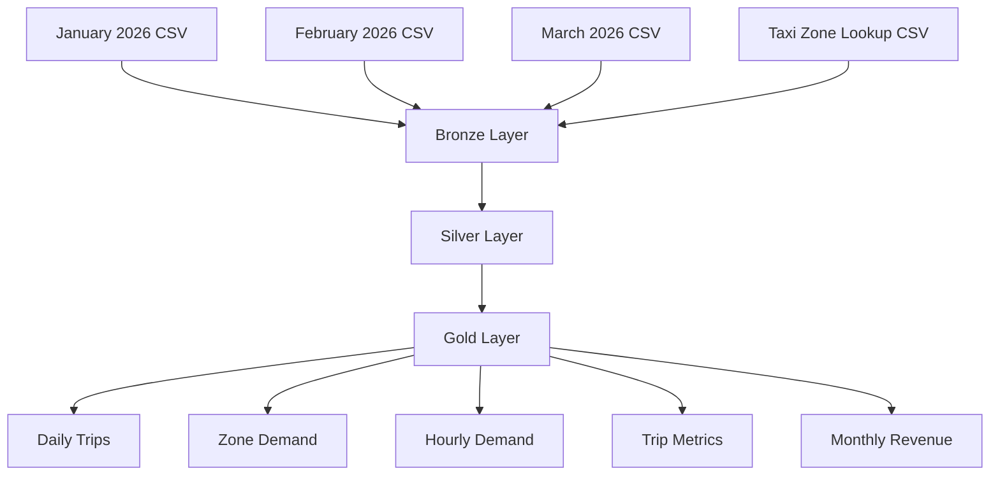

# NYC Yellow Taxi Data Pipeline – Architecture

## 1. Architecture Overview

This project uses the Medallion Architecture in Databricks to process NYC Yellow Taxi trip data.

The architecture consists of three layers:

- Bronze: Raw data ingestion.
- Silver: Data cleaning and validation.
- Gold: Business-ready analytical data.

The project uses batch ingestion and Delta Lake tables.

## 2. Technology and Platform

| Component | Technology |
|---|---|
| Data platform | Databricks Free |
| Catalog | Unity Catalog |
| Catalog name | workspace |
| Schema name | taxi |
| Storage format | Delta Lake |
| Ingestion method | Batch |
| Transformation languages | SQL and Python (PySpark) |
| Version control | GitHub |

## 3. Unity Catalog Structure

The project uses one schema to organise all three Medallion layers.

Proposed structure:

```text
workspace (catalog)
    |
    └── taxi (schema)
          |
          ├── bronze_yellow_trips
          ├── bronze_taxi_zones
          |
          ├── silver_yellow_trips
          ├── silver_taxi_zones
          |
          ├── gold_daily_trips
          ├── gold_zone_demand
          ├── gold_hourly_demand
          ├── gold_trip_metrics
          └── gold_monthly_revenue
```

All tables will use the following naming convention:

- `bronze_` for raw data.
- `silver_` for cleaned and validated data.
- `gold_` for analytical data.

Example fully qualified table name:

`workspace.taxi.bronze_yellow_trips`

## 4. Data Sources

The pipeline uses the following source files:

- NYC Yellow Taxi trip data – January 2026.
- NYC Yellow Taxi trip data – February 2026.
- NYC Yellow Taxi trip data – March 2026.
- Taxi Zone Lookup CSV.

The source files are loaded into Databricks using Unity Catalog Volumes.

## 5. Medallion Architecture Layers

### 5.1 Bronze Layer

Purpose: Store ingested source data with minimal changes.

Tables:

- `bronze_yellow_trips`
- `bronze_taxi_zones`

Responsibilities:

- Ingest monthly CSV files.
- Preserve the original source columns and values where possible.
- Store the data in Delta format.
- Add ingestion metadata where appropriate.
- Support traceability back to source files.

### 5.2 Silver Layer

Purpose: Produce clean, standardised and validated data.

Tables:

- `silver_yellow_trips`
- `silver_taxi_zones`

Responsibilities:

- Standardise column names and data types.
- Handle missing and invalid values.
- Validate trip dates and numerical values.
- Check data quality rules.
- Prepare reliable data for analytical processing.

### 5.3 Gold Layer

Purpose: Provide business-ready data for operational analysis.

Proposed tables:

| Table | Purpose |
|---|---|
| `gold_daily_trips` | Daily taxi trip volumes |
| `gold_zone_demand` | Trip demand by pickup zone |
| `gold_hourly_demand` | Trip demand by hour |
| `gold_trip_metrics` | Average trip distance and duration |
| `gold_monthly_revenue` | Monthly taxi revenue |

These tables will support the business questions defined in `docs/plan.md`.

## 6. Data Flow

The pipeline follows this sequence:

1. Download monthly Yellow Taxi CSV files and the zone lookup file.
2. Store the files in Unity Catalog Volumes.
3. Ingest the source files into Bronze Delta tables.
4. Clean and validate data in Silver tables.
5. Transform Silver data into Gold analytical tables.
6. Use Gold tables for reporting and analysis.

## 7. Architecture Diagram



## 8. Implementation Approach

The implementation will be developed incrementally using Databricks notebooks.

- SQL will be used for database setup, transformations and analytical queries.
- Python/PySpark will be used for data processing and transformations.
- Delta Lake will be used for storing processed tables.
- GitHub will maintain project code and documentation.

## 9. Design Decisions

| Decision | Selected Approach | Reason |
|---|---|---|
| Architecture | Medallion | Separate raw, clean and analytical data |
| Ingestion | Batch | Process monthly source files |
| Catalog | Unity Catalog | Centralised data organisation |
| Schema | One schema named `taxi` | Simple structure for the learning project |
| Layer identification | Table prefixes | Distinguish Bronze, Silver and Gold |
| Storage format | Delta Lake | Reliable data storage and processing |
| Languages | SQL and PySpark | Learn both approaches |

## 10. Future Improvements

Potential future enhancements include:

- Incremental data ingestion.
- Automated data quality monitoring.
- Pipeline orchestration.
- Additional months of taxi data.
- Performance optimisation.
- Dashboard development.
